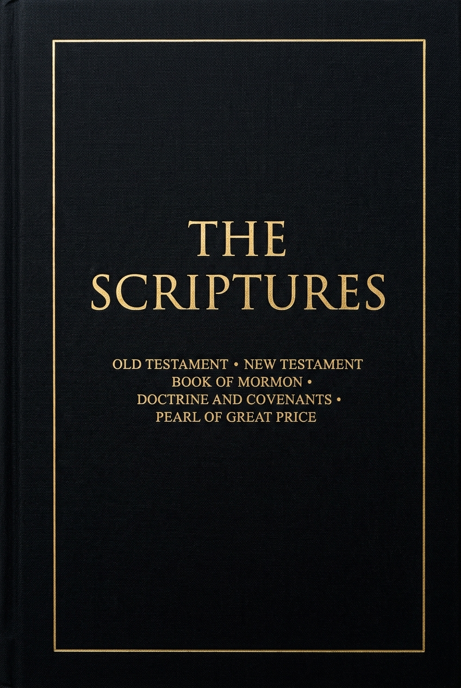

# Minimal Scriptures EPUB

A clean, minimalist, high-contrast EPUB edition of the complete **LDS Canon of Holy Scripture**, tailored specifically for distraction-free reading and fast page turning on **Amazon Kindle Paperwhite** and other e-ink readers.



---

## The LDS Canon

This edition contains the complete standard works of The Church of Jesus Christ of Latter-day Saints in their traditional canonical order:

1. **The Old Testament** (King James Version, 39 books, 929 chapters)
2. **The New Testament** (King James Version, 27 books, 260 chapters)
3. **The Book of Mormon: Another Testament of Jesus Christ** (Title page, testimonies of the witnesses, and all 15 books from 1 Nephi through Moroni)
4. **The Doctrine and Covenants** (Sections 1 through 138, including clerk and prophet signatures)
5. **The Pearl of Great Price** (Book of Moses, Book of Abraham with facsimile explanations, Joseph Smith—Matthew, Joseph Smith—History, and The Articles of Faith)

---

## Design Philosophy

- **Ultra-Minimalist & Pure Text**: No footnotes, cross-references, or distracting study aids—just the sacred text cleanly laid out verse by verse.
- **Kindle Paperwhite & E-Ink Optimized**:
  - High-contrast typography with pure black text on white background.
  - Fluid font sizing (`em`/`rem`) that responds smoothly to your Kindle's font size, font choice (Bookerly, Georgia, Baskerville, Amazon Ember, etc.), and line spacing sliders.
  - Superscript verse numbers designed with zero line-height shift to preserve rhythm and vertical alignment.
  - Chunked file sizes: all HTML documents are kept under 250 KB (including split parts for Alma and D&C) so page turns are instantaneous and memory never stutters on e-ink devices.
- **Fast Chapter Jumping**:
  - Compact chapter jump bars at the top of every multi-chapter book allow one-tap jumping to any chapter on Kindle.
  - Multi-level Table of Contents (`nav.xhtml` and `toc.ncx`) providing native Kindle menu navigation down to individual chapters.
  - In-book Table of Contents and volume index pages.
- **Modern EPUB 3 with EPUB 2 Dual-Navigation**:
  - Compatible with Amazon's **Send to Kindle** service, Kindle Scribe, Kindle Oasis, Kindle Paperwhite, Apple Books, Kobo, and Android e-readers.
  - Contains full Dublin Core metadata, cover page, and semantic landmarks.

---

## Building the EPUB

The generator is written in pure Node.js with **zero third-party dependencies**. It compiles all 40,000+ verses and 1,500+ chapters into `scriptures.epub` in under 2 seconds.

```bash
# Clone the repository
git clone https://github.com/michaelrussell4/minimal-scriptures-epub.git
cd minimal-scriptures-epub

# Build scriptures.epub
node build.js
# or
npm run build
```

The resulting `scriptures.epub` (~2.9 MB) is created directly in the project root.

---

## Loading onto Your Kindle Paperwhite

### Option 1: Send to Kindle (Recommended)
1. Go to [Amazon Send to Kindle](https://www.amazon.com/sendtokindle).
2. Drag and drop `scriptures.epub`.
3. Your Kindle will wirelessly download the book with full cover art and whisper-sync enabled.

### Option 2: USB Transfer
1. Connect your Kindle Paperwhite to your computer via USB.
2. If using Calibre or standard USB, copy `scriptures.epub` or convert to `.azw3`/`.kfx` if desired.

---

## Source Data & License

- Text data is based on the public domain [Scriptures in JSON](https://github.com/bcbooks/scriptures-json) compiled by Ben Crowder, reflecting the 2013 LDS adjustments.
- Code and compilation scripts are released under the [Creative Commons Zero (CC0 1.0) Public Domain Dedication](LICENSE).
